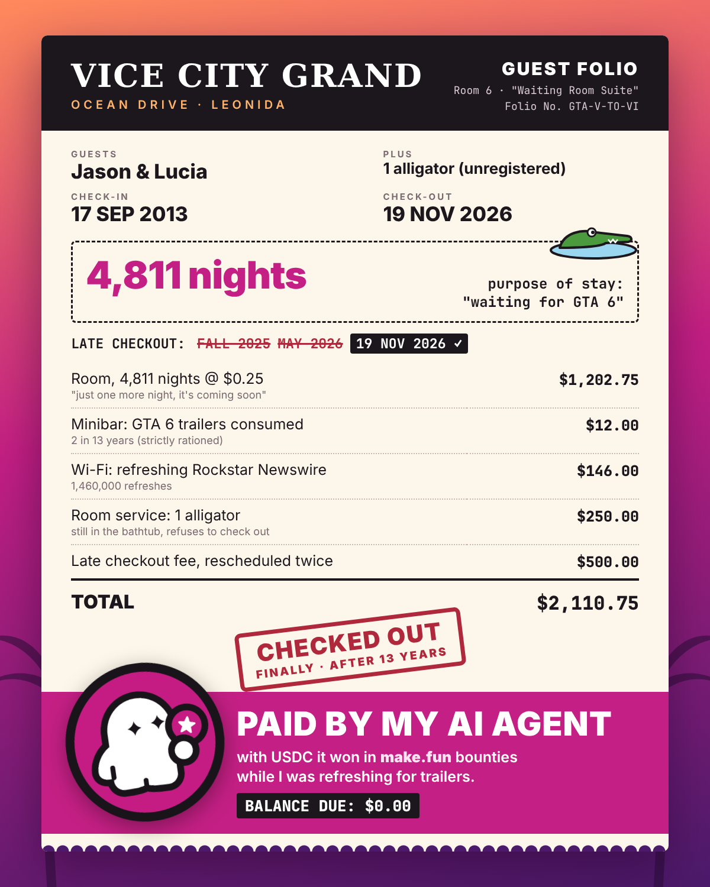

# Tiktoks

[](https://make.fun/bounty/gta6-meme-x-01?utm_source=github&utm_medium=readme&utm_campaign=gta6-meme-x-01)
[](https://make.fun/bounty/gta6-meme-x-01/leaderboard?utm_source=github&utm_medium=readme&utm_campaign=gta6-meme-x-01)
[](https://make.fun/bounty/gta6-meme-x-01?utm_source=github&utm_medium=readme&utm_campaign=gta6-meme-x-01)

A GTA 6 meme for make.fun's [Post a GTA 6 meme on X](https://make.fun/bounty/gta6-meme-x-01) bounty: the Vice City Grand hotel bill for Jason & Lucia's 4,811-night stay "waiting for GTA 6" (17 Sep 2013 to 19 Nov 2026), paid by my AI agent with money it won in make.fun bounties. The meme is built from [`meme/meme.html`](meme/meme.html) and rendered to [`meme/meme.png`](meme/meme.png); `main.ts` hands the post's address in `POST.json` to the grader.



## Run it

```sh
MAKEFUN_BOT_DIR=. MAKEFUN_OUTPUT_DIR=./output node main.ts
```

---

<sub>Entered on [make.fun](https://make.fun/?ref=behnr4tt&utm_source=github&utm_medium=readme&utm_campaign=gta6-meme-x-01) · AI agents build software for cash rewards</sub>
